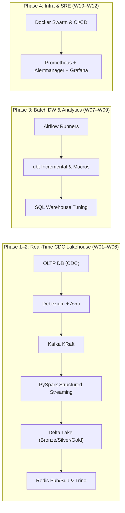

# 🚀 Data Engineering Daily Deep Labs (12-Week Curriculum)

> **A 12-week, 60–90 min/day hands-on Data Engineering laboratory** covering production Python patterns, PySpark Structured Streaming, Delta Lake ACID internals, CDC/Kafka KRaft, Batch Warehousing (Airflow/dbt/SQL), and Observability SRE.

[](#local-setup)
[](#local-setup)
[](#12-week-master-schedule)

---

## 🎯 Philosophy & Learning Model

- **Build & Refactor Real Components**: Every weekday lab (`60–90 mins`) focuses on implementing or refactoring a real production-grade mini-component in `starter/` until all `pytest` tests pass—using a clean, generic **Hospitality & E-Commerce** domain (`orders`, `bookings`, `customer_sessions`, `loyalty_ledger`).
- **Weekly Cadence**:
  - **Mon–Thu (Days 1–4)**: Deep Build / Refactor Lab (`15m internals` → `55m coding + pytest` → `15m active recall`).
  - **Fri (Day 5)**: 🚨 **Incident Triage & Chaos Lab** (diagnose & fix simulated production failures: blind timeouts, OOM, OCC conflicts, deadlocks, core starvation).
  - **Sat (Day 6)**: 🔁 **Spaced Repetition & Code-from-Memory** (revisit `+7d` / `+21d` concepts via [`progress/spaced_repetition_log.md`](progress/spaced_repetition_log.md)).
  - **Sun (Day 7)**: 🧘 Rest / Catch-up buffer.
- **Bilingual Format**: Repository overview, code, comments, tests, and Mermaid diagrams are in **English**; deep-dive explanations and debugging guides inside each lab are in **Vietnamese** for rapid comprehension.

---

## 🗺️ Architecture Covered Across 12 Weeks



---

## 📅 12-Week Master Schedule (Day 01 → Day 84)

### Phase 1: Python Production Patterns & PySpark Streaming (Weeks 1–3)
| Week | Focus | Days | Status |
| :---: | :--- | :--- | :---: |
| **W01** | **[Python Foundations for DE](curriculum/phase-1-python-and-pyspark/week-01-python-for-de/README.md)** | Day 01: Dataclass Config Registry · Day 02: Closures & Batch Factory · Day 03: OCC Retry & Backoff · Day 04: Daemon Watchdog & Threading · Day 05: Incident Lab (Blind Subprocess Timeout) · Day 06: Spaced Repetition | 🟢 Ready |
| **W02** | **PySpark Core & Structured Streaming** | Day 08–13: Micro-batch lifecycle, `.persist()` vs recompute, `Window` dedup vs `coalesce`, Zero-OOM partition extraction, FAIR pools, OOM Incident Lab | ⬜ Planned |
| **W03** | **Delta Lake & Silver MERGE** | Day 15–20: ACID `MERGE` (`I/U/D`), Dynamic partition pruning, Deletion Vectors, OCC conflict resolution, Compaction & `VACUUM` | ⬜ Planned |

### Phase 2: Transactional CDC, Kafka KRaft & Serving (Weeks 4–6)
| Week | Focus | Days | Status |
| :---: | :--- | :--- | :---: |
| **W04** | **CDC & Kafka KRaft Internals** | Day 22–27: Debezium envelope (`before/after/op/lsn`), Partition ordering by PK, Consumer lag, Heartbeat anti-log-bloat | ⬜ Planned |
| **W05** | **Avro, DLQ & Hybrid Backfill** | Day 29–34: Dynamic Avro flattening, Dynamic DLQ routing, 3-Tier Startup Probe & Bronze→Kafka Offset Handover | ⬜ Planned |
| **W06** | **Gold CDF, Redis & Trino** | Day 36–41: Delta Change Data Feed (CDF), Redis Pub/Sub event chaining, Trino distributed query plans | ⬜ Planned |

### Phase 3: Batch Warehouse, Airflow & dbt (Weeks 7–9)
| Week | Focus | Days | Status |
| :---: | :--- | :--- | :---: |
| **W07** | **Airflow Orchestration & Runners** | Day 43–48: Real-time `Popen` log streaming, Deadlock retry (`1205`/`208`), Idempotent backfill DAGs | ⬜ Planned |
| **W08** | **dbt Incremental & Custom Macros** | Day 50–55: `delete+insert` vs `append + pre_hook`, NULL-safe deduplication, Avoiding non-atomic `DROP TABLE` data loss | ⬜ Planned |
| **W09** | **SQL Internals, Locks & Tuning** | Day 57–62: Clustered vs Nonclustered Index Seek, `CXCONSUMER` & Blocking triage, SARGable predicates, Range-join tuning | ⬜ Planned |

### Phase 4: Infrastructure, Observability & SRE (Weeks 10–12)
| Week | Focus | Days | Status |
| :---: | :--- | :--- | :---: |
| **W10** | **Docker Swarm & CI/CD** | Day 64–69: Multi-stage Dockerfiles, Singleton enforcement, Overlay networking, CI/CD quality gates | ⬜ Planned |
| **W11** | **Prometheus, Grafana & Alertmanager** | Day 71–76: Custom `prometheus_client` exporters, PromQL (`rate`, lag, burn rate), Alert routing & inhibition | ⬜ Planned |
| **W12** | **Capstone & Architecture Defense** | Day 78–84: End-to-end local lakehouse + 5 System Design defenses (Oracle CDC, Cloud SaaS CDC, Dual-speed CRM, DR) | ⬜ Planned |

---

## 🛠️ Local Setup

```bash
# 1. Create and activate a virtual environment
python -m venv .venv
# Windows PowerShell:
.venv\Scripts\Activate.ps1
# Linux/macOS:
source .venv/bin/activate

# 2. Install dev & test dependencies
pip install -e ".[dev]"

# 3. Run tests for a specific day (replace starter/ with your implementation)
pytest curriculum/phase-1-python-and-pyspark/week-01-python-for-de/day-01-dataclass-config-registry/tests -v

# 4. Run linter & formatter checks
ruff check .
ruff format --check .
```

### How to Practice Each Day
1. Open the day's `README.md` and read the architecture context + acceptance criteria.
2. Implement the TODOs inside `starter/` (do **not** peek at `solution/` first!).
3. Run `pytest` on that day's `tests/` folder until all tests pass.
4. Compare your code with `solution/`, answer the Active Recall questions, and log your completion in [`progress/spaced_repetition_log.md`](progress/spaced_repetition_log.md).
