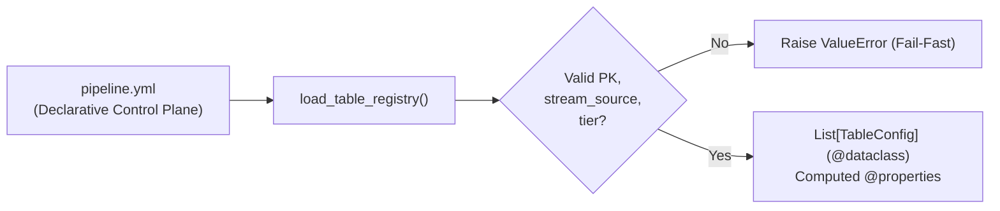

# 🛠️ Day 01: Declarative Dataclass Config Registry

> **Phase:** 1 · **Week:** W01 · **Time Budget:** 60–90 mins · **Type:** Build Lab  
> **Skills:** Python `@dataclass`, `@property`, YAML parsing, Defensive Validation, Type Hints (`Optional[T]`)

---

## 1. 🎯 Bối cảnh Production (15 phút)

Trong các hệ thống streaming hiện đại (ví dụ nền tảng CDC cho E-Commerce / Hospitality gồm hàng chục bảng như `orders`, `bookings`, `loyalty_ledger`), việc hardcode tên bảng, khóa chính, topic Kafka và đường dẫn S3 vào trong file job PySpark sẽ tạo ra cơn ác mộng bảo trì.

Giải pháp chuẩn là **Configuration-Driven Control Plane**:
- Mọi bảng được khai báo tập trung trong 1 file YAML (`pipeline.yml`).
- Một module loader (`config_registry.py`) đọc YAML, validate ngay lúc khởi động (**Fail-Fast**), và chuyển đổi thành danh sách object `@dataclass TableConfig` có kiểu dữ liệu rõ ràng và các thuộc tính dẫn xuất (`@property`) như `kafka_topic`, `bronze_path`, `silver_path`.



---

## 2. 📋 Yêu cầu kỹ thuật (Acceptance Criteria)

Mở [`starter/config_registry.py`](starter/config_registry.py) và hoàn thiện:
1. `@dataclass class TableConfig`:
   - Validation trong `__post_init__`:
     - `primary_key` phải là list không rỗng (nếu rỗng → raise `ValueError`).
     - `stream_source` chỉ chấp nhận `"kafka"` hoặc `"bronze"` (nếu khác → raise `ValueError`).
     - `tier` chỉ chấp nhận `"tier1"`, `"tier2"`, `"tier3"` (nếu khác → raise `ValueError`).
   - 3 `@property` tính toán tự động:
     - `kafka_topic`: `f"{self.topic_prefix}.{self.source_database}.{self.source_schema}.{self.name}"`
     - `bronze_path`: `f"s3a://bronze/{self.source_database.lower()}/{self.source_schema.lower()}/{self.name.lower()}"`
     - `silver_path`: `f"s3a://silver/{self.source_database.lower()}/{self.source_schema.lower()}/{self.name.lower()}"`
2. Hàm `load_table_registry(yaml_content: str, tier_filter: Optional[List[str]] = None) -> List[TableConfig]`:
   - Parse YAML, bỏ qua các bảng có `enabled: false`.
   - Nếu `tier_filter` được truyền vào, chỉ trả về các bảng thuộc tier đó (không phân biệt hoa/thường).
3. Chạy test kiểm tra:
   ```bash
   pytest curriculum/phase-1-python-and-pyspark/week-01-python-for-de/day-01-dataclass-config-registry/tests -v
   ```

---

## 3. 🧠 Active Recall (15 phút sau khi code xong)
1. **Tại sao nên validate config trong `__post_init__` (Fail-Fast lúc startup) thay vì đợi đến khi Spark micro-batch chạy rồi mới kiểm tra?**
2. **Tại sao dùng `@property` cho `silver_path` thay vì bắt người vận hành phải gõ tay `silver_path` trong `pipeline.yml` cho từng bảng?**
