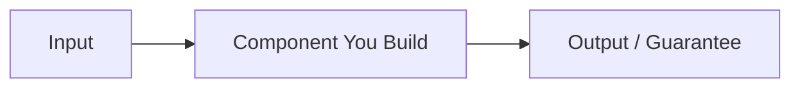

# 🛠️ Day XX: <Lab Title>

> **Phase:** Phase X · **Week:** WXX · **Time Budget:** 60–90 mins · **Type:** `<Build Lab | Refactor Lab | Incident Triage>`  
> **Skills:** `<Python / PySpark / Delta / SQL / SRE>`

---

## 1. 🎯 Bối cảnh Production (15 phút)
*Tại sao kỹ năng này quan trọng trên hệ thống thực tế? Nó giải quyết lỗi hay bottleneck nào?*



---

## 2. 📋 Yêu cầu kỹ thuật (Acceptance Criteria)
Mở file trong `starter/` và hoàn thiện các hàm/class còn `TODO` sao cho:
1. ...
2. ...
3. Chạy pass toàn bộ `pytest` trong `tests/`:
   ```bash
   pytest <path-to-day>/tests -v
   ```

---

## 3. 🧠 Active Recall (15 phút sau khi code xong)
1. **Câu 1**: *...*
2. **Câu 2**: *...*
